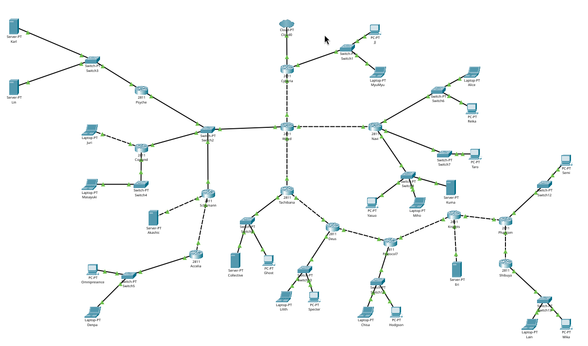
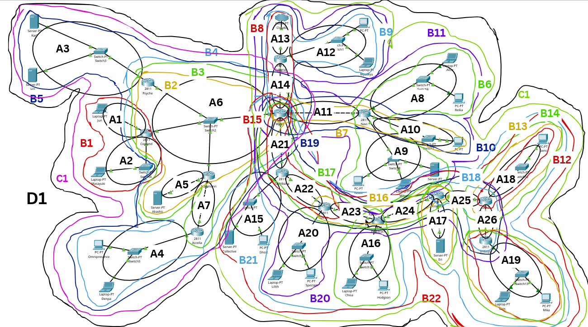
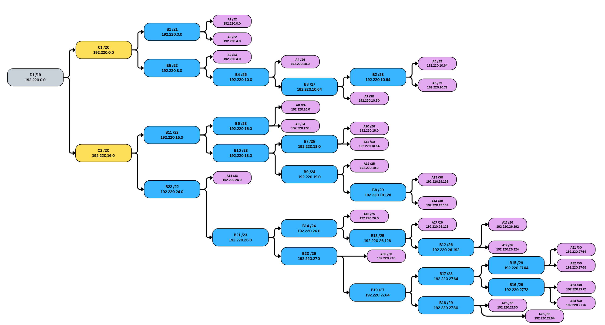
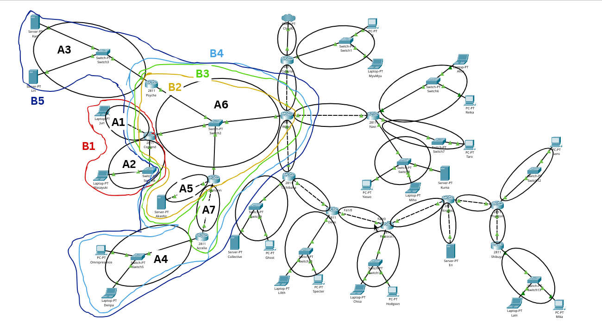
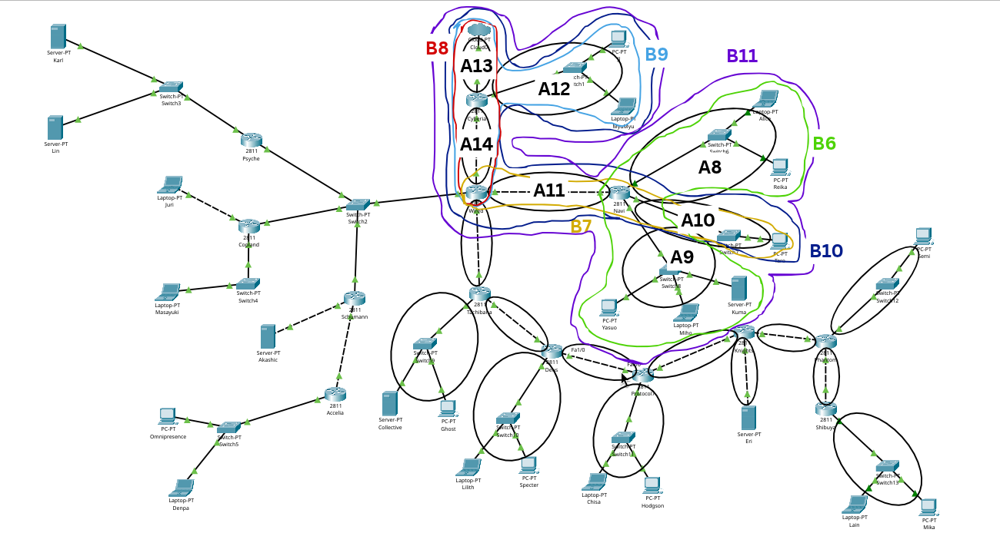
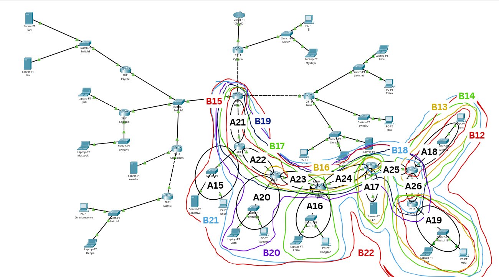

# Praktikum Jarkom Modul 4 - Kelompok K-18 

## Anggota

| Nama | NRP |
|---|---|
| Catur Setyo Ragil | 5027251066 |
| Senna Bagus Harimurti | 5027251106 |

## Laporan

- Spreadsheet: [Subnetting Modul 4 - K18](https://docs.google.com/spreadsheets/d/16MgZ-wjODwT19-tLmBUZSpoHsj5G79vuBlR4NnrGunE/edit?usp=sharing)

## Topologi CPT

Semua host memakai IP statis. Switch2 adalah LAN transit untuk 4 router
(Psyche, Copland, Schumann, Wired), dan hanya Cyberia yang terhubung ke Cloud.

## Subnetting CIDR

Aturan: **jumlah IP = host + alamat interface router** pada subnet tersebut.

- Total host: **2.777**.
- Alamat non-host: **39** (38 interface router + 1 sisi Cloud).
- Kebutuhan mentah: **2.816**.
- Setelah pembulatan per subnet: **4.192 alamat**.
- `/20` = 4.096 alamat → tidak cukup; **`/19` = 8.192 alamat** → dipakai.

Contoh:

| Subnet | Prefix | Butuh | Perhitungan |
|---|---|---|---|
| A1 | /22 | 881 | Karl 700 + Lin 180 + Psyche 1 |
| A2 | /22 | 514 | Omni 510 + Denpa 3 + Accelia 1; `/23` hanya 510 |
| A8 | /24 | 254 | Alice 208 + Reika 45 + Navi 1; pas 254 |
| A12 | /25 | 126 | JJ 95 + MyuMyu 30 + Cyberia 1; pas 126 |
| A20 | /26 | 62 | Lain 57 + Mika 4 + Shibuya 1; pas 62 |

Tabel lengkap 26 subnet ada di `Subnetting_Modul4_K-18.xlsx` sheet
**Pembagian IP - CIDR**.

## Supernet

Penggabungan memakai **smallest covering prefix**:

- **C1 `/20`** = A1-A7 (sayap kiri).
- **C2 `/20`** = A8-A26 (sayap kanan).
- **D1 `/19`** = C1 + C2.
- B-level utama: **B5 `/22`** (A3-A7), **B11 `/22`** (A8-A14),
  **B22 `/22`** (A15-A26), B14 `/24`, B20 `/25`.

Zoom area supernet:

Total alokasi 4.192 dari 8.192 alamat; sisa 4.000 adalah ekor blok induk yang
tidak dialokasikan. Detail penggabungan ada di sheet **Penggabungan - CIDR**.

## Routing dan NAT

- Semua router: OSPF process 1, area 0.
- LAN pengguna `passive-interface`; link `/30` memakai
  `ip ospf network point-to-point`.
- Cyberia meng-originate default route dan menjalankan NAT overload untuk
  `192.220.0.0/19`.
- Konfigurasi CPT: [`routings/cpt/konfigurasi-cpt-K18.txt`](routings/cpt/konfigurasi-cpt-K18.txt).
