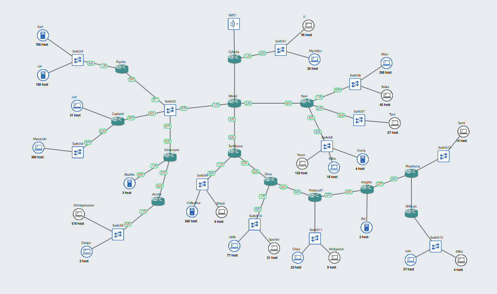

# Praktikum Jarkom Modul 4 - Kelompok K-18 

## Anggota

| Nama | NRP |
|---|---|
| Catur Setyo Ragil | 5027251066 |
| Senna Bagus Harimurti | 5027251106 |

## Laporan

- Spreadsheet: [Subnetting Modul 4 - K18](https://docs.google.com/spreadsheets/d/16MgZ-wjODwT19-tLmBUZSpoHsj5G79vuBlR4NnrGunE/edit?usp=sharing)

## Topologi CPT


Semua host memakai IP statis. Switch2 adalah LAN transit untuk 4 router
(Psyche, Copland, Schumann, Wired), dan hanya Cyberia yang terhubung ke Cloud.

## Subnetting CIDR

Aturan: **jumlah IP = host + alamat interface router** pada subnet tersebut.

- Total host: **2.777**.
- Alamat non-host: **39** (38 interface router + 1 sisi Cloud).
- Kebutuhan mentah: **2.816**.
- Setelah pembulatan per subnet: **4.192 alamat**.
- `/20` = 4.096 alamat → tidak cukup; **`/19` = 8.192 alamat** → dipakai.

Contoh:

| Subnet | Prefix | Butuh | Perhitungan |
|---|---|---|---|
| A1 | /22 | 881 | Karl 700 + Lin 180 + Psyche 1 |
| A2 | /22 | 514 | Omni 510 + Denpa 3 + Accelia 1; `/23` hanya 510 |
| A8 | /24 | 254 | Alice 208 + Reika 45 + Navi 1; pas 254 |
| A12 | /25 | 126 | JJ 95 + MyuMyu 30 + Cyberia 1; pas 126 |
| A20 | /26 | 62 | Lain 57 + Mika 4 + Shibuya 1; pas 62 |

Tabel lengkap 26 subnet ada di `Subnetting_Modul4_K-18.xlsx` sheet
**Pembagian IP - CIDR**.

### Tabel host dan subnet

| Host | Subnet | CIDR | IP | Mask | Gateway |
|---|---|---|---|---|---|
| Karl | A1 | 192.220.0.0/22 | 192.220.0.2 | 255.255.252.0 | 192.220.0.1 |
| Lin | A1 | 192.220.0.0/22 | 192.220.0.3 | 255.255.252.0 | 192.220.0.1 |
| Omnipresence | A2 | 192.220.4.0/22 | 192.220.4.2 | 255.255.252.0 | 192.220.4.1 |
| Denpa | A2 | 192.220.4.0/22 | 192.220.4.3 | 255.255.252.0 | 192.220.4.1 |
| Masayuki | A3 | 192.220.8.0/23 | 192.220.8.2 | 255.255.254.0 | 192.220.8.1 |
| Juri | A4 | 192.220.10.0/26 | 192.220.10.2 | 255.255.255.192 | 192.220.10.1 |
| Akashic | A5 | 192.220.10.64/29 | 192.220.10.66 | 255.255.255.248 | 192.220.10.65 |
| Alice | A8 | 192.220.16.0/24 | 192.220.16.2 | 255.255.255.0 | 192.220.16.1 |
| Reika | A8 | 192.220.16.0/24 | 192.220.16.3 | 255.255.255.0 | 192.220.16.1 |
| Yasuo | A9 | 192.220.17.0/24 | 192.220.17.2 | 255.255.255.0 | 192.220.17.1 |
| Miho | A9 | 192.220.17.0/24 | 192.220.17.3 | 255.255.255.0 | 192.220.17.1 |
| Kuma | A9 | 192.220.17.0/24 | 192.220.17.4 | 255.255.255.0 | 192.220.17.1 |
| Taro | A10 | 192.220.18.0/26 | 192.220.18.2 | 255.255.255.192 | 192.220.18.1 |
| JJ | A12 | 192.220.19.0/25 | 192.220.19.2 | 255.255.255.128 | 192.220.19.1 |
| MyuMyu | A12 | 192.220.19.0/25 | 192.220.19.3 | 255.255.255.128 | 192.220.19.1 |
| Collective | A15 | 192.220.24.0/23 | 192.220.24.2 | 255.255.254.0 | 192.220.24.1 |
| Ghost | A15 | 192.220.24.0/23 | 192.220.24.3 | 255.255.254.0 | 192.220.24.1 |
| Lilith | A16 | 192.220.26.0/25 | 192.220.26.2 | 255.255.255.128 | 192.220.26.1 |
| Specter | A16 | 192.220.26.0/25 | 192.220.26.3 | 255.255.255.128 | 192.220.26.1 |
| Chisa | A17 | 192.220.26.128/26 | 192.220.26.130 | 255.255.255.192 | 192.220.26.129 |
| Hodgson | A17 | 192.220.26.128/26 | 192.220.26.131 | 255.255.255.192 | 192.220.26.129 |
| Eri | A18 | 192.220.26.192/29 | 192.220.26.194 | 255.255.255.248 | 192.220.26.193 |
| Semi | A19 | 192.220.26.224/27 | 192.220.26.226 | 255.255.255.224 | 192.220.26.225 |
| Lain | A20 | 192.220.27.0/26 | 192.220.27.2 | 255.255.255.192 | 192.220.27.1 |
| Mika | A20 | 192.220.27.0/26 | 192.220.27.3 | 255.255.255.192 | 192.220.27.1 |

Subnet mengikuti penomoran xlsx/CPT. Gambar `assets/subnet.png` memakai
penomoran A1-A4 yang berbeda, jadi jangan dicampur saat demo.

## Supernet

Penggabungan memakai **smallest covering prefix**:

- **C1 `/20`** = A1-A7 (sayap kiri).
- **C2 `/20`** = A8-A26 (sayap kanan).
- **D1 `/19`** = C1 + C2.
- B-level utama: **B5 `/22`** (A3-A7), **B11 `/22`** (A8-A14),
  **B22 `/22`** (A15-A26), B14 `/24`, B20 `/25`.


Zoom area supernet:


Total alokasi 4.192 dari 8.192 alamat; sisa 4.000 adalah ekor blok induk yang
tidak dialokasikan. Detail penggabungan ada di sheet **Penggabungan - CIDR**.

## Routing dan NAT

- Semua router: OSPF process 1, area 0.
- LAN pengguna `passive-interface`; link `/30` memakai
  `ip ospf network point-to-point`.
- Cyberia meng-originate default route dan menjalankan NAT overload untuk
  `192.220.0.0/19`.
- Konfigurasi CPT: [`routings/cpt/konfigurasi-cpt-K18.txt`](routings/cpt/konfigurasi-cpt-K18.txt).

## Pengujian

### Testing

1. Buka `modul4-K18.pkt`; pastikan semua link hijau.
2. **Host ke gateway:** PC → Desktop → Command Prompt → `ipconfig`, lalu
   `ping <gateway>` sesuai tabel host. Contoh JJ: `ping 192.220.19.1` → 4/4.
3. **Router:** masuk CLI → `enable`, lalu:

```
show ip interface brief
show ip route
show ip ospf neighbor
```

Yang diharapkan: interface `up/up`, 26 route per router, dan neighbor FULL.

4. **Ping antar-cabang:** dari Karl `ping 192.220.27.3` (Mika), dari
   Omnipresence `ping 192.220.19.2` (JJ), dari Mika `ping 192.220.0.2` (Karl).
   Semua harus 4/4. Ping pertama boleh 3/4 karena ARP; ulangi sekali.
5. **NAT:** dari JJ `ping 8.8.8.8` (timeout normal), lalu di Cyberia:

```
show ip nat translations
```

Harus muncul translasi `192.220.19.2 → 192.220.19.133`.

Checklist lengkap ada di `routings/cpt/99-verify.txt`.

### Hasil

| Uji | Hasil |
|---|---|
| OSPF neighbor | 13 router, 30 neighbor, FULL (2WAY hanya antar-DROTHER) |
| Routing table | 26 route per router (connected + OSPF + default) |
| Ping host ke gateway | 25/25 berhasil |
| Ping antar-cabang | 18 pasangan, semua 4/4 |
| NAT Cyberia | Translasi terbentuk, mis. `192.220.19.2 → 192.220.19.133` |

## Topologi GNS3 (VLSM)


Topologi GNS3 dibangun menggunakan **52 node**: 1 NAT (`NAT1`), 13 Router Linux, 13 Ethernet Switch, dan 25 Client Linux. Semua host menggunakan IP statis. Router `Cyberia` adalah satu-satunya gerbang keluar yang terhubung ke `NAT1` (Cloud/Internet), dan `Wired` bertindak sebagai *core distribution hub* yang menghubungkan seluruh cabang.
---
## Subnetting VLSM (GNS3)
Aturan: **Jumlah IP = host + alamat interface router** pada subnet tersebut.
- Total host riil: **2.777 host** (ditambah 37 interface router internal).
- Kebutuhan mentah: **2.814 IP**.
- Perhitungan disusun dengan metode **Descending Order (kebutuhan host terbesar ke terkecil)** agar memenuhi batas biner alami (*Natural Binary Boundary*) dan menghasilkan **0 wasted space**.
- Total alokasi presisi muat rapat di dalam blok agregat **`192.220.0.0/19`** (rentang `192.220.0.0` s/d `192.220.16.91`).
### Contoh Pembagian Subnet VLSM:
| Subnet | Prefix | Butuh | Perhitungan & Keterangan |
|---|---|---|---|
| **A4** | /22 | 881 | Karl 700 + Lin 180 + Psyche 1; pas di blok 1.024 |
| **A9** | /22 | 514 | Omnipresence 510 + Denpa 3 + Accela 1; `/23` hanya 510 |
| **A6** | /23 | 301 | Masayuki 300 + Copland 1; pas di blok 512 |
| **A15** | /23 | 267 | Collective 260 + Ghost 6 + Tachibana 1 |
| **A11** | /24 | 254 | Alice 208 + Reika 45 + Navi 1; pas tepat 254 host usable |
| **A13** | /24 | 143 | Yasuo 120 + Miho 18 + Kuma 4 + Navi 1 |
| **A1** | /25 | 126 | JJ 95 + MyuMyu 30 + Cyberia 1; pas 126 usable |
| **A2** | /30 | 2 | Point-to-point Cyberia <-> Wired; 0 IP terbuang |
---
### Tabel Host dan Subnet (VLSM - GNS3)
| Host | Subnet | Prefix / CIDR | IP Address | Netmask | Default Gateway |
|---|---|---|---|---|---|
| **Karl** | A4 | `192.220.0.0/22` | `192.220.0.2` | `255.255.252.0` | `192.220.0.1` (Psyche) |
| **Lin** | A4 | `192.220.0.0/22` | `192.220.0.3` | `255.255.252.0` | `192.220.0.1` (Psyche) |
| **Omnipresence** | A9 | `192.220.4.0/22` | `192.220.4.2` | `255.255.252.0` | `192.220.4.1` (Accela) |
| **Denpa** | A9 | `192.220.4.0/22` | `192.220.4.3` | `255.255.252.0` | `192.220.4.1` (Accela) |
| **Masayuki** | A6 | `192.220.8.0/23` | `192.220.8.2` | `255.255.254.0` | `192.220.8.1` (Copland) |
| **Collective** | A15 | `192.220.10.0/23` | `192.220.10.2` | `255.255.254.0` | `192.220.10.1` (Tachibana) |
| **Ghost** | A15 | `192.220.10.0/23` | `192.220.10.3` | `255.255.254.0` | `192.220.10.1` (Tachibana) |
| **Alice** | A11 | `192.220.12.0/24` | `192.220.12.2` | `255.255.255.0` | `192.220.12.1` (Navi) |
| **Reika** | A11 | `192.220.12.0/24` | `192.220.12.3` | `255.255.255.0` | `192.220.12.1` (Navi) |
| **Yasuo** | A13 | `192.220.13.0/24` | `192.220.13.2` | `255.255.255.0` | `192.220.13.1` (Navi) |
| **Miho** | A13 | `192.220.13.0/24` | `192.220.13.3` | `255.255.255.0` | `192.220.13.1` (Navi) |
| **Kuma** | A13 | `192.220.13.0/24` | `192.220.13.4` | `255.255.255.0` | `192.220.13.1` (Navi) |
| **JJ** | A1 | `192.220.14.0/25` | `192.220.14.2` | `255.255.255.128` | `192.220.14.1` (Cyberia) |
| **MyuMyu** | A1 | `192.220.14.0/25` | `192.220.14.3` | `255.255.255.128` | `192.220.14.1` (Cyberia) |
| **Lilith** | A17 | `192.220.14.128/25` | `192.220.14.130` | `255.255.255.128` | `192.220.14.129` (Deus) |
| **Specter** | A17 | `192.220.14.128/25` | `192.220.14.131` | `255.255.255.128` | `192.220.14.129` (Deus) |
| **Juri** | A5 | `192.220.15.0/26` | `192.220.15.2` | `255.255.255.192` | `192.220.15.1` (Copland) |
| **Taro** | A12 | `192.220.15.64/26` | `192.220.15.66` | `255.255.255.192` | `192.220.15.65` (Navi) |
| **Chisa** | A19 | `192.220.15.128/26` | `192.220.15.130` | `255.255.255.192` | `192.220.15.129` (Protocol7) |
| **Hodgeson** | A19 | `192.220.15.128/26` | `192.220.15.131` | `255.255.255.192` | `192.220.15.129` (Protocol7) |
| **Lain** | A25 | `192.220.15.192/26` | `192.220.15.194` | `255.255.255.192` | `192.220.15.193` (Shibuya) |
| **Mika** | A25 | `192.220.15.192/26` | `192.220.15.195` | `255.255.255.192` | `192.220.15.193` (Shibuya) |
| **Semi** | A23 | `192.220.16.0/27` | `192.220.16.2` | `255.255.255.224` | `192.220.16.1` (Phantoma) |
| **Akashic** | A7 | `192.220.16.40/29` | `192.220.16.42` | `255.255.255.248` | `192.220.16.41` (Schumann) |
| **Eiri** | A21 | `192.220.16.48/29` | `192.220.16.50` | `255.255.255.248` | `192.220.16.49` (Knights) |

---
## Konfigurasi Jaringan Permanen (`/etc/network/interfaces`) — [REVISI]
Setiap node Docker pada GNS3 menyimpan file antarmuka statis pada `/etc/network/interfaces` sehingga terbaca resmi pada jendela **Edit config** GUI GNS3 dan tidak hilang saat container restart.
Format standar yang diterapkan pada seluruh host:
```text
auto eth0
iface eth0 inet static
	address <IP Address>
	netmask <Netmask>
	gateway <Gateway>
	up echo nameserver 8.8.8.8 > /etc/resolv.conf
```
> File referensi copy-paste siap pakai untuk ke-25 node tersedia di: [`KONFIGURASI_COPY_PASTE_SEMUA_NODE_VLSM.md`](KONFIGURASI_COPY_PASTE_SEMUA_NODE_VLSM.md).
---
## Routing dan NAT (GNS3)
1. **Hierarchical Static Routing:**
   - **Router Edge/Cabang:** Memasang *Default Route* (`0.0.0.0/0`) yang mengarah ke hop berikutnya menuju router Core (`Wired` / `Cyberia`).
   - **Router Core (Wired & Tachibana):** Memegang tabel *Specific Subnet Route* untuk meneruskan paket balik ke masing-masing cabang tujuan.
2. **NAT & Gateway:**
   - Router `Cyberia` terhubung ke `NAT1` pada interface `eth0` (mendapatkan IP DHCP otomatis).
   - Menjalankan **iptables Source NAT (MASQUERADE)** untuk mentranslasikan seluruh blok alamat privat `192.220.0.0/19`:
     ```bash
     iptables -t nat -A POSTROUTING -o eth0 -j MASQUERADE
     ```
3. **Penyimpanan Script Permanen (Aturan Praktikum No. 5):**
   - Seluruh script konfigurasi disimpan pada direktori `/root/init.sh` di setiap node container.
   - Cara eksekusi manual di konsol node:
     ```bash
     bash /root/init.sh
     ```
---
   Buka konsol router (misal `Wired`, `Cyberia`, `Tachibana`, `Navi`), jalankan:
   ```bash
   ip -br a
   ip route
   ```
   *Target:* Seluruh interface `UP` dan tabel rute memiliki rute yang sesuai dengan tabel VLSM.
3. **Uji Multi-Hop Antar-Cabang (Cross-Branch):**
   - **Karl (cabang Psyche) ke Lain (cabang Shibuya):** Melintasi 8 router secara berturut-turut.
     ```bash
     ping -c 3 192.220.15.194
     ```
     *Hasil:* 3 packets transmitted, 3 received, **0% packet loss**.
   - **Alice (cabang Navi) ke Omnipresence (cabang Accela):** Uji silang dari sayap kanan ke sayap kiri.
     ```bash
     ping -c 3 192.220.4.2
     ```
     *Hasil:* 3 packets transmitted, 3 received, **0% packet loss**.
   - **Lain (cabang Shibuya) ke JJ (cabang Cyberia):** Uji cabang terjauh ke router gateway.
     ```bash
     ping -c 3 192.220.14.2
     ```
     *Hasil:* 3 packets transmitted, 3 received, **0% packet loss**.
4. **Uji Akses Internet (NAT Masquerade):**
   Dari client pengguna:
   ```bash
   ping -c 3 8.8.8.8
   ```
   *Hasil:* Berhasil menerima balasan dari IP publik eksternal melalui NAT Masquerade `Cyberia`.

   ---
### Tabel Hasil Pengujian GNS3
| Skenario Pengujian | Titik Uji Asal & Tujuan | Target Hasil | Hasil Aktual | Status |
|---|---|---|---|---|
| **Konektivitas Lokal** | 25 Client ke Default Gateway masing-masing | 0% Loss | 25/25 Berhasil | **LULUS (100%)** |
| **Lintas Cabang Ekstrem** | Karl (`192.220.0.2`) → Lain (`192.220.15.194`) | 0% Loss | 3/3 Received (0% Loss) | **LULUS** |
| **Lintas Sayap Kanan-Kiri** | Alice (`192.220.12.2`) → Omnipresence (`192.220.4.2`) | 0% Loss | 3/3 Received (0% Loss) | **LULUS** |
| **Cabang ke Gateway Core** | Lain (`192.220.15.194`) → JJ (`192.220.14.2`) | 0% Loss | 3/3 Received (0% Loss) | **LULUS** |
| **Akses Internet (NAT)** | Client Host → Internet DNS (`8.8.8.8`) | Reply / Translasi Terbentuk | 0% Loss via Cyberia eth0 | **LULUS** |
---
